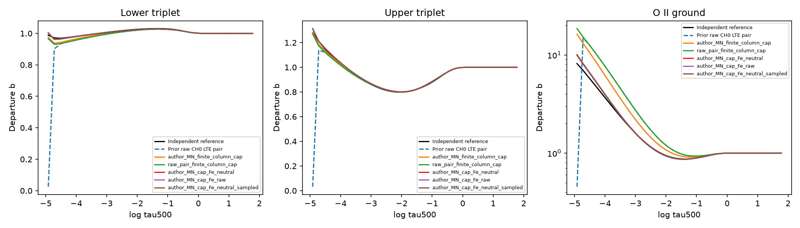
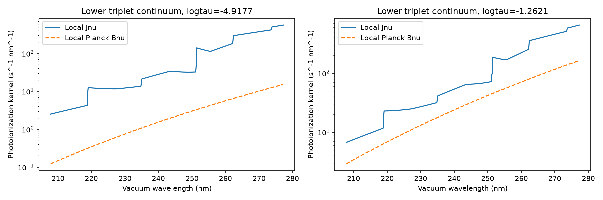
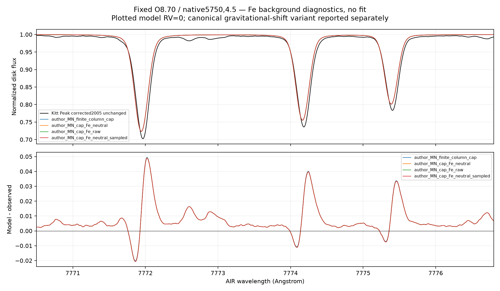

# Source-derived Fe I background: oxygen controls

RYA-1281 / parent RYA-1278, 2026-10-29. Scientific **HOLD**. Three bounded Mac
oxygen experiments complete; no fitted opacity factor, abundance fit, production
emission or default background change. This is1D at the native5750/4.5/O8.70
reference node, not full3D or a calibrated solar abundance.

## Source and intervention

The independent TS Fe I bf packet follows the component diagnosis in
ts_fe_continuum_review.md. The protected-source native baseline/reporting pair
is rerun over requested2000-3500A AIR; native100sample extension is preserved.
The resulting1601samples cover200.064818-360.102716nm vacuum. All56 native depths
and the exact source mixture are retained. Native Fe population/EOS and component
receipts define both raw specific opacity and net opacity per neutral Fe atom.
The latter includes the source's LTE level weighting; it is not a universal
single-level cross-section. Complete native logs/DATA remain external.

An explicit provider computes the existing backend background, subtracts its
passive Fe I bound-free contribution within the packet support, then adds the
source-derived alternative. Its emission change is exactly delta-chi times local
Planck Bnu; scattering is unchanged. Active O, source-MN collision convention,
native mass-column cap, atmosphere, O8.70, xi1,3SE rays and5flux rays stay fixed.
The provider refuses changed T/ne/nH/depth arrays; no new star or10K interpolation
is silently supported. Outside this declared finite support the original Fe
continuum is deliberately retained. This bounded splice is not full native
background or producer replication.

Actual-backend tests prove replacement rather than double counting, identity
when the supplied Fe opacity equals the existing one, LTE emission consistency,
unchanged scattering, repeatable recomputation, deepcopy safety and rejection of
a10K node change. Solver, continuum replay, rate replay and photoionization
receipts retain the packet/adapter identity. The fixed-physics parameter-grid
analyzer rejects these interventions; a dedicated observation audit is separate.

## Predeclared controls and numerical results

All cases keep1500outer iterations/600seconds, joint outer1e-6 and fixed-population
radiation/cap1e-8 limits. No threshold was relaxed. The first two use the prior
SE wavelength grid. The third inserts every Fe packet sample at unchanged physics
to test integration resolution. Plans and implementation were committed before
the corresponding new solves (85346551,06d31eb2,609a7d27).

| Control | Outer steps | Seconds | Top O II b | Max all-level/depth absolute b difference |
|---|---:|---:|---:|---:|
|Prior sourced-MN cap, existing background|291|199.81|16.25202|8.08396|
|Fe packet / local neutral Fe normalization|358|197.38|10.05880|1.89074|
|Fe packet / raw native specific opacity|296|174.39|9.91448|1.74642|
|Neutral normalization + packet sampling|362|239.96|9.96451|1.79645|

Independent reference top O II b=8.16806. The max-b diagnostic difference falls
by about77-78%; it is not a statistical accuracy estimate or a certified absolute
ion-fraction error. Native producer LTE normalization/Ne inputs remain unheld.
The extra spectral samples move top O II by0.94% relative to the neutral case,
well below the remaining reference discrepancy but not a proof of final grid
convergence. Further resolution checks remain owed before admission.

Not every population improves: the maximum all-depth upper-triplet difference
is0.02620 before Fe replacement versus0.03124/0.03218/0.03175 afterwards. Over
the declared logtau[-3,0] diagnostic subset it changes from0.00556 to about0.00616.
That subset is not an observational contribution function. No normalization or
case is selected because it lies closest to the reference.

## Fresh radiation/rate and UV photoionization evidence

Each saved population set is replayed with newly converged radiation/cap and its
exact Fe packet, without an SE update. Local LTE and external reference b on
conserved local LTE populations are separate shape interventions.

| Fe control | Fresh own-NLTE max imbalance | External-b/local-LTE max imbalance |
|---|---:|---:|
|Neutral|4.54215e-7|0.093055|
|Raw specific|3.55670e-7|0.085676|
|Neutral + packet sampling|4.82436e-7|0.088293|

Prior sourced-cap external-b imbalance was0.329475. These reference-shaped
populations remain non-equilibria of the tested model; no native MULTI R/J dump
has been fabricated or substituted.

Independent raw-cross-section quadrature for the top lower-triplet continuum:

| Control | Independent rate (s^-1) | Backend (s^-1) | J-weighted / local-Planck rate |
|---|---:|---:|---:|
|Prior background|16248.9998|16244.5438|64.6221|
|Neutral|8241.2548|8238.9512|32.7754|
|Raw specific|8065.7319|8063.4775|32.0773|
|Neutral + packet sampling|8111.3518|8107.3807|32.2916|

The independently sourced Fe intervention approximately halves this UV rate and
reduces the O II discrepancy without tuning to departures. This establishes a
controlled background-opacity effect, not complete agreement or a unique cause
for every remaining difference. Independent linear-sigma integration and backend
WENO/weights differ by up to0.049% at these selected samples; both are retained.

## Visible triplet and unchanged Kitt Peak

Intrinsic fixed +/-0.5A triplet areas in mA:

| Control |7771.944|7774.166|7775.388|
|---|---:|---:|---:|
|Prior background|68.77763|59.23043|46.28034|
|Neutral|68.92270|59.35592|46.37732|
|Raw specific|68.92768|59.36033|46.38085|
|Neutral + packet sampling|68.92454|59.35750|46.37851|

The numerical sampling control changes these areas by at most0.00184mA. The
physical Fe intervention changes them by about0.10-0.15mA, much less than the
remaining observational gap. Kitt Peak's unchanged corrected/pre-normalized
holding passes the same canonical telluric/normalization policy. Delivered
vacuum coordinates are converted once to **AIR** for comparison; model frequencies
remain vacuum internally. The observed continuum and velocity are not refitted.

After fixed canonical solar macro/rotation and catalog-R broadening, sampled
model areas are68.89297/59.33649/46.36776mA versus observed
77.55651/67.20039/53.79430mA. The native benchmark atmosphere is not the canonical
Sun; incomplete weak blends, continuum physics and approximate Gaussian rather
than measured FTS LSF remain explicit. These are fixed-input diagnostics, not an
abundance result or chi-square acceptance test.

A separately predeclared canonical gravitational-shift variant changes RMS but
not this conclusion. The plot shows RV=0, with that variant reported in JSON.
An initial plot autoscaled using unseen convolution-edge points; v2 crops only
the displayed plot, and every numerical metric/profile hash is unchanged.

## Reproduction, verification and remaining work

Source packet: experiments.bride_fe_packet / fe-nuv-packet-v1. Native source run:
experiments.bride_mac_grid / rya1281-ts-nuv-v1. Solves: rya1281-fe-neutral-v1,
rya1281-fe-raw-v1, rya1281-fe-sampled-v1. Final comparison: fe-background-analysis-v3;
three fresh-rate/photo directories; final Kitt comparison fe-kitt-peak-v2. Older
analyses remain immutable. Review copies and registered invocations are under
data/results/rya1281/fe_background_v1; inspected figures are under data/output.
Full rate arrays and native logs remain external with hashes.

131 focused science tests plus3 installed-iSpec checks pass. The initial iSpec
selection in the isolated LW venv failed for absent pandas; it passed in its
intended project environment, with no dependency/code workaround. A nice19 attempt
was denied by the Mac sandbox and the first solver continued at ordinary priority;
all cases are one-thread Mac jobs. The daemon restart lost its PTY session, but
fresh history writes proved the sampled worker survived; it was not restarted or
duplicated. All three final manifests are CONVERGED_EXPERIMENT and all owned
science/replay jobs finished. No Sirius science was started.

Next refine spectral integration as required, validate remaining passive continuum
and H-wing absorption/scattering contracts with actual producer evidence, and
separate the visible residuals using source-supported blend/LSF/velocity handling.
Validate native-column interpolation and regenerate background packets before
canonical-Sun/10K temperature tests. Then finish solar O, C/N, Fe, another star.
Background, collision, boundary, exact producer and full3D/all-band gates remain
open. No source-derived opacity is adopted as a production default here.
