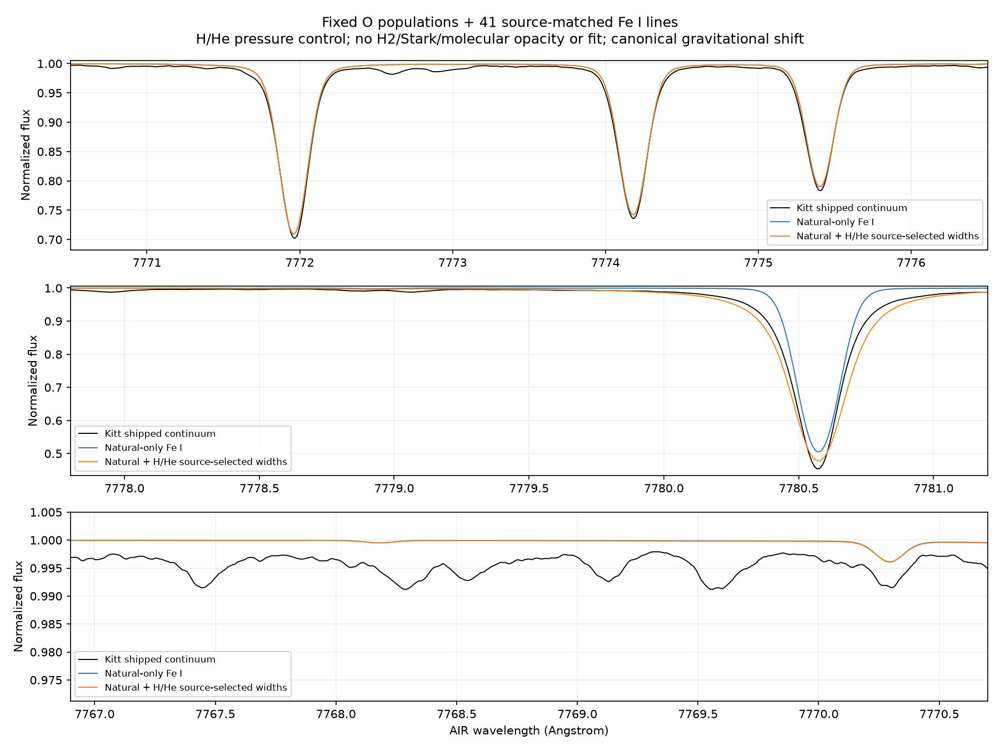

# Source-selected neutral-collision Fe I broadening

RYA-1281, 2026-11-02, Mac only. Fixed solar5772/g4.438/xi1/O8.70 populations,
41 exact source-matched FeI trace lines, same continuum/background/binding/cap.
Experimental atomic O777 static1D only; scientific HOLD. This is supporting
opacity work for oxygen, not the future Fe abundance milestone.

## Source branch and units verified before transfer

Original pinned iSpec21269948750e2177fe32c5df38e1d9bb81363374 contains
Turbospectrum `source/bsyn.f`, `depth.f`, `anstee.f` and
`DATA/Anstee-1802-2014.dat` (beneath synthesizer/turbospectrum).
All source/data bytes checked against that git commit before compilation.
Native Fe ionization energy7.902eV read from the original IRWIN atomic table.

Important: negative GES fdamp does NOT automatically select its tabulated width.
BSYN first calls Anstee for suitable transitions; the negative field selects W
only after that routine returns U. Actual41-line oracle result:
34W(tabulated10000K),4A,2C,1B(quantum recipes). No guessed recipe or width scale.
The same source sets a=Gamma/(4*pi*Doppler_width); ABO half-width is multiplied
by2 in DEPTH. The Python line kernel retains that convention, avoiding a
half/full-width or factor2 error.

Compiled only original ANSTEE/interpolation plus extracted unchanged W/ABO and
GAMMLN fragments, with a new unit-driver and existing gfortran16.1. Bounds checks,
legacy default REAL, -fno-automatic; original source/table/binaries untouched.
Driver supplies explicit recorded LW masses/constants converted to cgs, so this
checks imported equations/selection, NOT full TS EOS/constant/spectrum parity.
At5772K and nH/nHe/nH2=1e23/1e22/1e20m^-3,41 native widths versus Python port
agree within5.94718e-7 relative. Arithmetic guard128*eps(float32)=1.52588e-5 is
an engineering bound, not a stellar-model accuracy threshold. Raw input/native
stdout, driver/binary/source hashes and compiler command retained; original
Fortran/table copies remain external, no full source vendoring.

The neutral-width port uses explicit SI number densities and converts to cm^-3.
W scales as(T/10000)^0.3. Quantum cross sections/velocity exponents come from the
actual oracle; source coefficients and the helium polarizability factor0.41336
are preserved. H2 factor0.85 supported by the mathematical interface/test, but
not included in this first transfer control.

## Explicit collider/recipe scope

Actual neutral H and He come from the current LTE populations, not total H
nuclei. H0/Htotal ranges0.954446-0.9999998 across56 depths; collider tables saved.
LW molecular table is empty in this existing model. H2=0 here is an EXPLICIT
OMISSION, not an assertion that the physical gas contains none.

Native MARCS corner partial-pressure ratios screen H2's potential size:
0.85*nH2/nHI maxima0.00037968/0.00070700/0.00023411/0.00044609 for
5750/g4,5750/g4.5,6000/g4,6000/g4.5 respectively. These are original rounded
log-pressure table ratios, not target5772 chemistry, interpolation validation or
a rigorous error bound. They support reporting a bounded omission, not a claim
of full perturber/EOS closure.

Stark broadening is also deliberately absent. DEPTH has supplied-width and
Cowley fallback branches; the installed iSpec line writer does not pass the
original source-row Stark field in this export path, leaving GAMST=0 in BSYN.
Simply applying that row as though it reproduced the native producer would be
incorrect. Qualify the two explicit conventions separately next.

No component/isotope/molecular/other-species opacity or SE/electron-density
feedback added. Trace Fe Kurucz/native reservoir mismatch1.031-1.185 remains
reported. Natural-only and pressure variants use identical dense4001point VIS
sampling, original UV samples, same bound continuum, source parameters and cap.

## Matched transfer result

Scalar radiative-width behavior is preserved while the kernel now also accepts
one width per depth. New natural-only flux is **array-identical** to previous
natural-only trace result. O populations array-identical throughout; paired
continuum arrays exactly equal. Cache checks include actual neutral colliders,
so changing H/He populations cannot silently reuse stale widths.

|AIR O centre|Natural-only intrinsic mA|With H/He intrinsic mA|Added pressure mA|
|---|---:|---:|---:|
|7771.944|72.083685|72.130430|0.046745|
|7774.166|62.325921|62.414360|0.088439|
|7775.388|48.792034|48.934381|0.142347|

Including prior41line contribution, total intrinsic additions over O-only are
0.12661/0.23994/0.15026mA, all below0.25mA. This subset/pressure term does not
explain the several-mA window gap. It does not exclude other opacity or changes
in a future coupled O SE solve.

Canonical broadening+gravitational-shift areas72.10769/62.38611/48.93541mA;
zero-RV variant retained separately. No fit or free continuum/width/RV/abundance.
Maximum profile difference0.21908 is in the wider Fe region, not a22% O change.
FeI7780.557 wings change substantially and can overshoot parts of the observed
profile; a more favorable wing match elsewhere is not an adoption criterion.

## Continuum controls remain separate

Existing model-guided levels become0.9967926/0.9986447/0.9926361, all numerical
passes. Corrected observed areas74.58838/65.93416/46.77524mA. Initial blue/red
anchors90/0,90/0,31/59: geometry still depends strongly on opacity. Third observed
window again becomes weaker than model. IAG-reference and observed-envelope
controls remain unchanged; no choice is adopted to minimize a residual. Fixed
populations are intentional for isolation; a coupled SE rerun remains owed
before admitting an updated NLTE spectrum.

## Validation and handoff

32 tests pass:10 pressure/source/trace/kernel/binding tests and22 cap/observable/
reference/local-continuum regressions with Mac profile. Tests cover native
Fortran arithmetic/units, density/temperature scaling, depth-vector versus
independent single-depth profiles, invalid shape/density, actual pressure
context and changed-neutral-population refusal, scattering preservation,
deepcopy, original complete-input guards and source packet tamper rejection.
No verified new production/science defect; no fabricated bug-ledger row.

Natural/HHe replays11.241/11.135s; process-lifetime peak RSS737345536/738754560
bytes (~703/705MiB),1thread and host loads recorded. Timing begins after input
reconstruction; memory includes imports/setup. Not prior SE/grid/full3D telemetry.
Radiation/cap1e-8,1000iteration/180s budget unchanged.

Final external roots under registered experiments.bride_mac_grid:
rya1281-fe-pressure-source-v2(v1 retained),natural-final-v1,pressure-final-v1,review-final-v1,
synthesis-final-v1,iag-final-v1 (all with prefix rya1281-fe-pressure-).16compact artifacts
and3figures at fe_pressure_v1, actual generators/invocations. Original compiled
oracle/driver/table/source copies and raw native stdout remain receipted externally.
Final CSV exports use explicit LF terminators; earlier CRLF development outputs
remain external, not silently normalized copies. Native stdout whitespace is
preserved externally; parsed recipes/widths and raw hash are in archived receipt.
Registerv201/SEQUENCE and trace-opacity row updated; child In Progress, parent
In Review, stacked draft598. No source data/atom/observations/gold/adopted values,
production ORCH, merge/publication or scientific gate changed.

Next: source-branch Stark controls, explicit H2/perturber qualification,6 combined
FeI entries and other source-backed species/molecules; then continuum geometry/
reference spread, velocity/FTS-LSF, fresh-bound xi and coupled O SE. C/N before
Fe abundance and another star remains the goal; full3D/all-band remain open.
