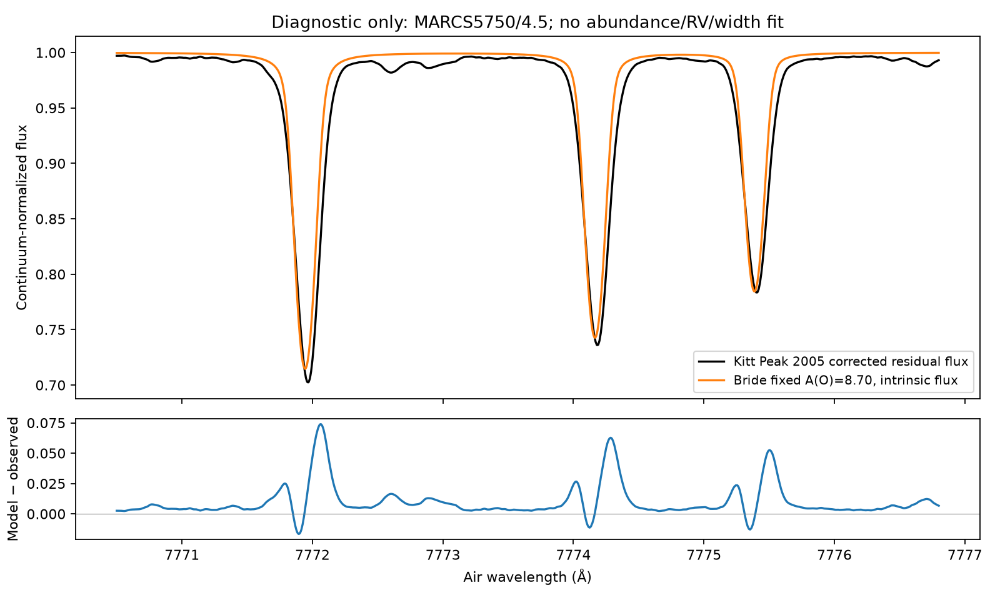

# First Kitt Peak comparison: fixed-input oxygen flux diagnostic

Ryan selected Kitt Peak as the first observed check. This compares the three777nm
lines with the registered **solar_kpno_kurucz2005_corrected** residual irradiance
atlas. It reuses the converged full41-level O populations at the exact
MARCS5750/4.5 reference node and **fixed A(O)=8.70**. No abundance was fitted.

| Air centre (Å) | Model absorption area (mÅ) | Kitt Peak absorption area (mÅ) | Model deficit |
|---|---:|---:|---:|
| 7771.944 | 61.31 | 77.56 | 20.95% |
| 7774.166 | 53.08 | 67.20 | 21.02% |
| 7775.388 | 41.84 | 53.79 | 22.22% |

These are predeclared **fixed-window integrals within ±0.5Å**, not isolated
oxygen-only total EWs. The observed windows include weak blends and the published
pseudo-continuum. No observed continuum was re-fitted or velocity/width optimized.
Unweighted profile RMS is2.66%,2.27%,1.88%; these are not reduced chi-square or
uncertainty estimates. The model line minima are0.7146/0.7427/0.7845 compared with
observed0.7024/0.7359/0.7835. Similar depths, especially for the third line, hide
substantial width/area disagreement. The overlay also shows wavelength/asymmetry
residuals and weak absorption absent from the model.

## What is now matched and checked

- **Flux geometry:** surface Fν=2π∫Iν(μ)μdμ from5 and10 outward Gauss-Legendre
  rays. The normalized flux changes by at most8.27e-6 between these quadratures.
  The displayed result uses10 rays. It is not π times the vertical intensity.
- **Continuum:** a separate formal-transfer context with O bound-bound lines
  removed retains the original fixed NLTE bound-free populations and structure.
  Both line and continuum radiation fields converge without changing populations
  (63 and35 iterations, threshold1e-8). The LTE line profile is not a continuum.
- **Replay identity:** the reconstructed full-line context reproduces the prior
  converged disk-centre intensity to3.33e-15 relative. Source/reference/population
  hashes and LTE population arrays are checked before using saved populations.
  Shared context construction now owns the unchanged solve/replay physics.
- **Observed identity:** path-register key data.kurucz2005_residual resolves
  irradrelwl.dat on Sirius.11934143bytes; SHA256
  75dd93479b5d3fe63c2e7828f5dbb3ce29f4c672f4f1147e0d30ce41bc8f5adb.
  Header explicitly says residual irradiance, vacuum nm including gravitational
  redshift. The shared reader converts once to canonical air Å and preserves
  published residual flux.631 observed samples cover the output window.
- **Isolation:** one thread/nice19,900s internal/1000s external cap. Completed
  in43.15s. Raw spectra, all earlier products, frozen gold and adopted abundances
  remain unchanged. Original population solve commit is df866b4e; this generator
  and shared constructor are committed at9ddae7bd. No new SE/abundance solve.

## Interpretation and limits

The current model supplies less absorption than the Kitt Peak data in all three
windows. This is a real observational diagnostic; it does not identify a unique
cause or yield a new oxygen abundance. Numerical angular-integration differences
are small relative to the window-area differences.

The comparison is deliberately intrinsic: no stellar macroturbulence, rotation
or FTS line-spread convolution was applied. Delivered gravitational redshift and
convective line shifts were not fitted or removed. Width/shape residuals therefore
cannot yet adjudicate atomic physics. Finite-window areas can also change with
convolution; they are not a substitute for a full blend-aware EW/flux fit.

The5750/4.5 atmosphere differs from canonical solar5772/4.438; source microturbulence
is1km/s. Molecular opacity and a complete observed weak-blend spectrum are absent.
Corrected holding identity does not supply a local pixel covariance/telluric
residual budget. Independent MULTI departures still disagree. None of these
limitations was corrected by adjusting gf, collisions, abundance or continuum.

The earlier good Kitt Peak oxygen work is preserved as context:
data/results/solar_cno_redo_rya485.json records the Kurucz1984/Wallace swap test,
and pipeline/cno_synthesis.py owns production CNO fitting. This new comparison
uses the explicitly named corrected2005 product; its fixed-input41-level Bride
experiment must not be presented as a like-for-like replacement for earlier
Turbospectrum plus grid-correction abundance products.

**Next:** retain this baseline; apply independently specified solar broadening,
frame/LSF and blend controls, prepare a matched solar-atmosphere control, and
resolve the MULTI opacity/EOS/rate-convention disagreement before any abundance
fit/admission. Do not increase A(O) merely to make this overlay agree.

## Artifacts, reproduction and checks

- [Manifest and per-line diagnostics](../../../data/results/rya1281/kitt_peak_fixed_v1/manifest.json)
- [Flux, continuum, observed samples and residuals](../../../data/results/rya1281/kitt_peak_fixed_v1/profiles.csv)
- Generator: scripts/compare_bride_kitt_peak.py; result manifest registry includes
  the complete invocation. Use a new output directory. Original Sirius outputs:
  /mnt/codex-data/codex/rya1281/kitt-peak-fixed-v1/.

Focused local regression suite158passed; Sirius targeted tests20passed. The extra
project-environment route/holding checks yield13passed20skipped and one existing
failure: the old six-band corrected1984 test assumes5000Å cannot be served, but
the expanded holding now serves it. Reproduced the same behavior by executing
the original4542033b loader under the same fixture environment. It is unrelated
to the2005 reader extraction and remains visible. A brittle inline-source vacuum
check was replaced with a behavioral shared-reader units/flux check. An initial
new fixture wrongly assumed the canonical approximate air↔vacuum routines were
exact inverses; it now verifies the reader's actual one-way conversion contract,
without changing the canonical conversion or any science tolerance.

No new scientific-code defect was identified; observed/model disagreement is an
open validation finding, not a fabricated bug-ledger entry. No production, merge,
publication, solar abundance or full3D gate is signed off.

All three review copies match original Sirius SHA256 hashes. Result-generator
and invocation checks report2436violations both here and against main's manifest/
tracked tree, with zero new violations. Register freshness and whitespace pass.
The six non-stale holding-addressability tests pass; the pre-existing failing
test remains unchanged. State registerv177 records this observation diagnostic.

Acknowledgement: NSO/Kitt Peak FTS data used here were produced by NSF/NOAO;
the selected residual irradiance product is credited to Kurucz2005 as its header
and holding registry specify.
