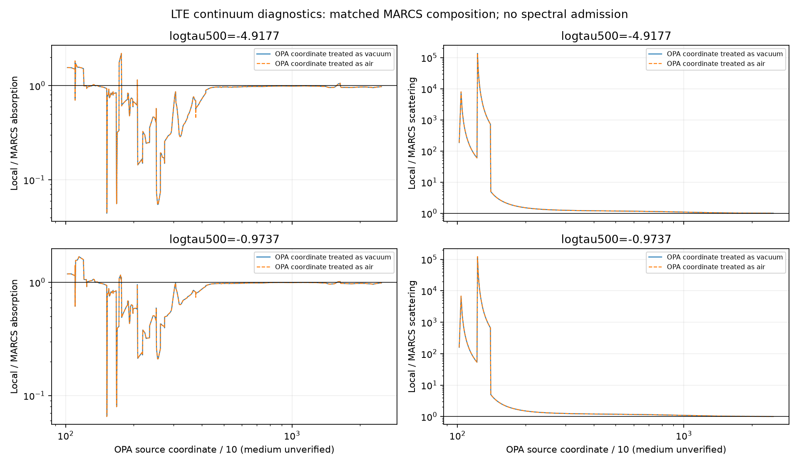

# Conditional MARCS continuum and component budgets

RYA-1281 / parent RYA-1278, 2026-10-29. Scientific **HOLD**. This is an LTE
coefficient diagnostic, not an NLTE solution, oxygen abundance or producer-parity
claim. No solver opacity was replaced and no observed spectrum was changed.

## Controls and coordinate evidence

The exact held MARCS5750/4.5 structure and its receipted OPA companion were used
at all56 depths. Four cases cross two coordinate hypotheses (OPA source values
treated as vacuum or as air, converted with the canonical project converter)
with two oxygen inputs: the model's8.66 and the benchmark's8.70. All other
composition, atmosphere, full O41 input and passive atomic factories stay fixed.
This is a declared composition control, not a fitted abundance. Both coordinate
hypotheses remain labeled conditional; neither is adopted. Below2000A the
project convention retains vacuum in both hypotheses. Kitt Peak remains AIR.

OPA sampling pairs at3647.97/3648.05A and8209.20/8209.25/8209.30A surround vacuum
hydrogen edges. Held Turbospectrum babsma.f explicitly lists3648.04 and8209.26A
as vacuum edges and converts them to air for its own calculation. This supports
a vacuum interpretation of the source OPA coordinates, but does not establish
the exact MARCS file-generation contract. Turbospectrum's own opacity-output
coordinates must not be silently assigned to the upstream MARCS file.

Each case requests the exact822 OPA samples from1018.31 to24841.76A as extra
backend vacuum-nm wavelengths. No interpolation of local coefficients across
edges is used. O lines are removed for this continuum diagnostic, with O LTE
bound-free transitions retained as detailed-static. All other atoms are passive.
One formal call captures actual chi/eta; arrays prove populations did not change.
There is no SE iteration, converged scattering-radiation claim or cap intervention.
Total chi minus background chi records explicit O bound-free opacity; total chi
minus background scattering gives absorption. Divide by the held density to
obtain m2/kg, matching the OPA's correctly unnormalized specific coefficients.

Independent source-based budgets reconstruct each passive atom's bound-free
contribution and H/He ground-state resonant Rayleigh plus electron Thomson
scattering. Residual basic absorption and molecular scattering are retained,
not forced to zero. The test checks actual-backend LTE Kirchhoff consistency,
component positivity/closure, exact sample inclusion and unchanged populations.
The installed backend binary, factories and inspected source files are receipted.

## Results

Ratios below use the vacuum-coordinate hypothesis at matched MARCS composition;
they are selected samples, not band-wide error bounds. Source coordinates are
shown in A, with their medium still unverified.

| Source sample | Local/MARCS absorption at logtau=-4.9177 | At logtau=-0.9737 |
|---|---:|---:|
|1302.37|0.992725|1.033322|
|1353.94|0.996019|1.001972|
|2769.76|0.267519|0.499348|
|5000.72|0.969266|0.976126|
|7779.95|0.985149|0.991192|
|16044.80|1.046834|1.014937|
|21964.00|0.962601|0.970689|

At2769.76A, changing the coordinate interpretation changes top local absorption
by0.067649%; changing O8.66 to8.70 changes it by0.0000931%. Neither explains the
large local/MARCS difference at this sample. At the top, Si bound-free contributes
40.976% of local absorption, Mg20.108%, Fe3.277%, Al0.704%; explicit O contributes
0.000965%. These identify **local** budgets, not the missing native MARCS component.
Native per-species opacity contributions are not supplied by this OPA file.

At1302.37A, local scattering is2574.62 times the OPA scattering;99.9918% of the
local value is reconstructed H resonant Rayleigh. However, local absorption is
32.5212 versus MARCS32.7595m2/kg there, whereas scattering is0.567943 versus
0.000220593m2/kg. A huge ratio in a small component is not a huge total-opacity
ratio. It also does not prove missing physical opacity: the held independent
Turbospectrum detabs.f explicitly turns H Rayleigh off below1400A, with a comment
that hydrogen-line code supplies the wing contribution as pure absorption;
hbop.f has the corresponding1400A cutoff. This is evidence of a real partition
convention in that source, not proof of the exact MARCS or MULTI producer setup.
Source-function/thermalization differences can matter even at similar extinction.

The passive inventory is H6, He9, C15, N16, Na16, Mg66, Al18, Si24, S18, Ca6,
Fe32 levels. Its continuum counts/edges are saved. These are particular held
RH-style atomic models, not a complete native MARCS continuum reconstruction.
Different cross-sections, partition functions/EOS and opacity partition remain
candidate causes. Do not label one missing species or scale an opacity to match.

## Evidence, validation and next work

Final immutable audit: experiments.bride_mac_grid/rya1281-marcs-continuum-v4;
analysis: rya1281-marcs-continuum-analysis-v2. Earlier versions remain. The four
complete coefficient/budget arrays remain external with hashes in report.json;
four small review artifacts are copied under data/results/rya1281/marcs_continuum_v1.
The inspected figure is under data/output/rya1281/marcs_continuum_v1. Reproduce with
the registered scripts and new immutable directories; analyze only hash-verified
arrays. Four final setup/capture cases total1.40seconds on the Mac, one thread.
No new Sirius work or background science process remains running.

120 focused backend/numerical/observable/parameter/reader tests pass, with666
known printUpdate deprecation warnings. Defaults and existing solve grids are
unchanged by the optional extra-wavelength argument. No new verified run bug:
existing collision_convention and boundary_contract remain open.

Next obtain a component-resolved independent continuum calculation at the same
T/Pe/composition, using held Mac tools where feasible. Prioritize Si/Mg/Fe and
H-/hydrogen contributions around the O photoionization supports, not an arbitrary
UV multiplier. Resolve hydrogen-wing absorption/scattering bookkeeping before
any background substitution; retain active-O accounting. Continue seeking actual
producer ne/nstar/J/rate/ABSDAT evidence and the upstream OPA coordinate contract.
Then test source-supported background controls against UV J/photoionization and
O II, with fresh residual checks. Validate column interpolation before capped
solar-parameter reruns. Solar O, then C/N, Fe, another star; 3D/all-band gates open.
