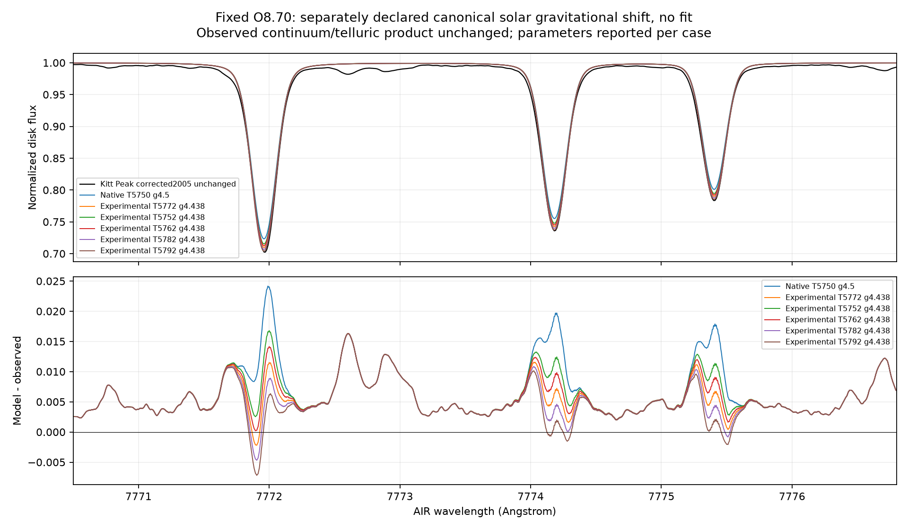

# Solar oxygen with exact-input opacity and explicit experimental columns

RYA-1281 / parent RYA-1278, 2026-11-02. **Five fresh 1D NLTE solar-temperature
controls completed on the Mac. Scientific HOLD remains.** No abundance fit,
production ORCH emission, gold/adopted change, merge or publication.

Base1565ce155087b08ff50c06210a98b0f3a6e0b98d; refreshed main f8c723a8 unchanged.
Implementation checkpointfdce0366 precedes the5772 solve; eb481a7c precedes the
four neighboring solves. Source/body hashes and original commit IDs are retained.

## Explicit input path and actual backend checks

The legacy native-only packet loader and native interpolated-cap refusal remain.
A separate opt-in path constructs density-integrated column mass with the declared
source-corner log-native top anchor, then issues a fresh complete local-input
binding. It does not edit the previous column-withheld certificate or flip its
admission flags. Cap is explicitly passed as an experimental object; the native
constructor path is separate. There is no free thickness/opacity/abundance factor.

The bound provider reuses the already tested subtract-old/add-new FeI background
calculation with **local-neutral normalization only**. Producer rho remains
separate; it is not substituted into local inputs. Runtime T/ne/nH, geometry,
micro/line-of-sight velocity and cap length are checked; actual composition and
active oxygen abundance are checked on construction. Fe must remain passive LTE.

Actual backend controls establish native coefficient array identity against the
legacy provider, context deepcopy, successful solar construction and refusal of
one-ULP runtime changes, changed cap/column/active abundance, and missing explicit
cap. These checks establish input/application integrity, not physical accuracy.
The original source certificate still rejects a newly added column; the new
explicit experiment records the changed column binding rather than bypassing it.

## Five solves, unchanged numerical budget

Full held41-level atom/256 lines/22 continua/1106 source collision tables,
source-derived MN LTE-pair collision convention, O8.70, xi1km/s, logg4.438,
56 depths,3 SE rays,qscale1,5 flux rays and all1601 Fe packet samples inserted in
the SE/continuum grid. Underlying fields use nearest5750-6000/g4-4.5 MARCS cell,
logPe/rho and log-layer interpolation. Each target receives its **own** source-
evaluated TS coefficients and new NLTE solve; output spectra are not interpolated.
No new atmosphere-equilibrium solution is claimed.

Original limits remain1500 outer iterations/600s per case, joint1e-6 convergence,
fixed-population cap/J tolerance1e-8. One CPU thread, serial Mac science; no Sirius
science or CI load requested. Runtime sums1074.20s (17.90min). Peak memory and
host-load telemetry were not captured, so this is measured wall time, not a full
memory/throughput budget or full3D scaling claim.

| Teff K | Iterations | Seconds | Intrinsic7771.944 area mA |7774.166 area mA|7775.388 area mA|
|---:|---:|---:|---:|---:|---:|
|5752|326|227.84|70.51549|60.83489|47.66796|
|5762|402|258.34|71.25837|61.50326|48.22461|
|5772|256|179.95|72.00382|62.17442|48.78412|
|5782|266|190.31|72.75188|62.84839|49.34650|
|5792|341|217.77|73.50249|63.52515|49.91176|

Areas are fixed +/-0.5 Angstrom absorption-window integrals, **not isolated total
oxygen EWs**. All curves use declared AIR centers7771.944/7774.166/7775.388;
recomputed native first-window area68.92510 differs very slightly from the older
68.92454 report because that report rounded the first center to7771.94. Its raw
flux is unchanged. The new comparison consistently uses7771.944 for every case.

Each+10K step changes the windows by0.7429-0.7506 /0.6684-0.6768 /
0.5567-0.5653mA. This is a smooth **parameter response within this cell**, not
10K physical accuracy, an inferred temperature, or a universal grid derivative.
Teff changes its constructed fields, cap and coefficients together. The native
5750/4.5 comparison also changes gravity, so that difference is not pure dEW/dT.

All joint diagnostics pass1e-6. Maximum particle-conservation error anywhere in
the five histories is1.965e-12 (limit1e-10), with zero rejected Ng retries.
Nominal5772 final population/J/cap changes8.62e-7/8.62e-7/3.54e-7, in-iteration
physical residual2.15e-15;36 continuum iterations. Its top lower/upper-triplet/OII
departures are1.00185/1.27866/9.93220. They are descriptive own-LTE ratios, not
errors against the independent reference at a different atmosphere.

## Fresh radiation and physical rates

All five saved population sets were rebuilt in fresh matched contexts, with
original fields/coefficients/collision and cap contracts checked. Radiation is
reconverged at fixed populations; no SE update, rescaling or external-reference
population substitution. Collision classes sum to the backend matrix, and
off-diagonal radiative/collision flows are reconstructed independently.

Fresh physical rate residuals span1.710e-7 to4.914e-7, all within the original
1e-6 outer criterion. Nominal residual4.285e-7 differs from the in-iteration
roundoff value because radiation is freshly converged after the final population
update. Both values are reported; do not describe the fresh equilibrium as
machine-exact. Each fresh radiation replay takes about6s/65 iterations.

Raw-linear-cross-section photoionization audits give lower-triplet top rates
8061/8230/8401/8575/8751s^-1 across the series. Nominal top J-weighted/Planck
ratio31.644; independent/backend integration difference0.04891%. The lower
continuum's raw support207.832-277.2477nm lies within the bounded Fe packet
support. Nonlocal J/B alone is not proof of opacity error or all-band validation.

## Unchanged Kitt Peak comparison

Same corrected2005 residual holding, source hash and shared canonical reader;
delivered vacuum nm converts once to standard-air Angstrom. RT remains vacuum.
Model comparison is normalized disk-integrated surface flux, not absolute Earth
irradiance. Existing normalization/telluric policy gates run; **no second
correction, local observed renormalization, continuum/RV/LSF/abundance fit**.

Canonical solar macro/rotation, catalog-R Gaussian proxy and separately declared
gravitational-shift variant are retained. Both variant plots are provided; one
is not selected by minimizing residuals. The delivered atlas includes the solar
gravitational shift. True FTS LSF, convective asymmetry, complete weak blends,
continuum-definition equivalence and local covariance remain unqualified.

| Window center AIR A | Native5750/4.5 broadened mA | Solar5772/4.438 broadened mA |Observed mA|Solar deficit|
|---:|---:|---:|---:|---:|
|7771.944|68.89297|71.97199|77.55651|7.20%|
|7774.166|59.33649|62.15361|67.20039|7.51%|
|7775.388|46.36776|48.77347|53.79430|9.33%|

Adding the predeclared gravitational shift changes areas only slightly; nominal
profile RMS becomes0.00644/0.00557/0.00543. These are unweighted flux residuals,
not chi-square, measurement uncertainty or an abundance admission. Temperature
changes affect the oxygen cores while neighboring weak residual features persist;
some warmer-model cores overshoot. Do not choose a wrong solar Teff to absorb
missing blends or continuum/model differences. A1D MARCS comparison at fixed
abundance is also not expected to certify full3D physics merely by matching data.

## Evidence, verification and remaining work

78 focused tests pass, including the actual backend/provider and native cap/
reference regressions. Fresh replay and photo audits pass for all five points.
Original runs, intermediate reviews and first zero-RV plots are retained; final
combined reviewv3 records all cases, no best-case filter. No new verified run bug
or silent fallback was discovered; no fabricated bug-ledger row. A scratch status
command typo was corrected without changing any science run.

Immutable Mac roots under experiments.bride_mac_grid:
- rya1281-solar-bound-v1 and rya1281-solar-bound-temperature-v1 (five raw cases)
- rya1281-solar-bound-review-v3 and rya1281-solar-bound-kitt-v3 (combined review)
- rya1281-solar-bound-rates-v1 / photo-v1 (nominal5772)
- rya1281-solar-bound-rates-T{5752,5762,5782,5792}-v1 and matching photo roots
- rya1281-solar-bound-diagnostics-v1 (exact-manifest/array joined summary)

Compact artifacts, raw histories/populations/flux/cap snapshots and source
receipts are mirrored under data/results/rya1281/solar_bound_v1; plots under
data/output/rya1281/solar_bound_v1. Full J/rate arrays remain hash-referenced in
the registered external store. Every copied artifact has its actual generator
and invocation; source data, previous certificates and old runs are immutable.

Next prioritize controlled weak-blend/continuum-definition and velocity/LSF
accounting using ORCH's declared holding/products, plus matched microturbulence
controls at the canonical solar point with fresh explicit bindings. Keep the
independent1D producer/background and cap-source-family checks open. Add memory/
load telemetry to the next measured compute envelope. Do not use abundance or
stellar parameters as nuisance corrections to force agreement. O remains first,
then C/N and Fe, before another star; atomic777nm does not validate molecular,
UV/IR/all-band,1.5D or full3D results. Scientific HOLD and human adoption/merge/
publication gates remain.
