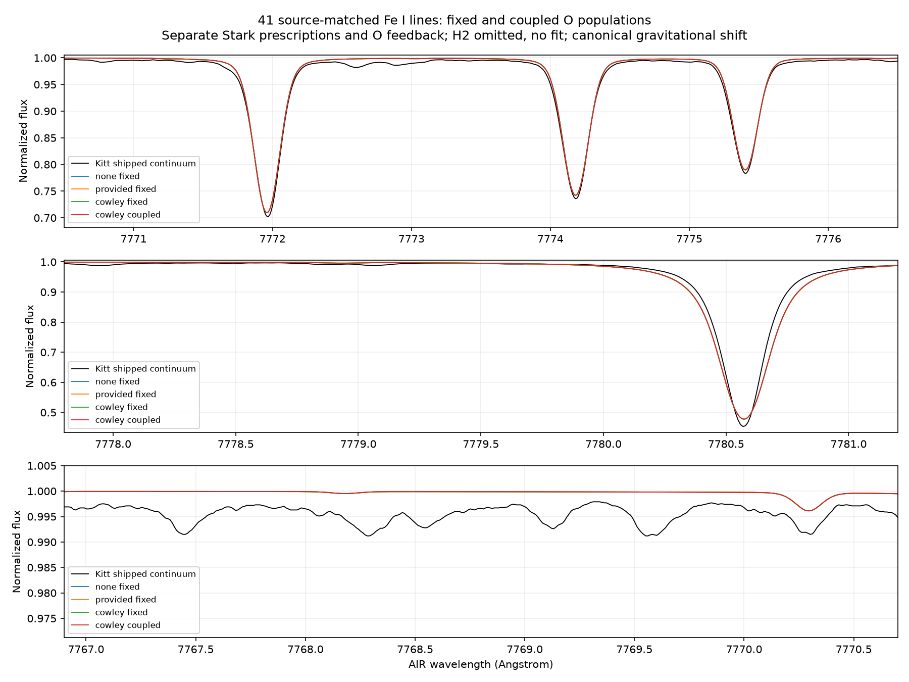

# Stark alternatives, H2 domain and coupled oxygen feedback

RYA-1281 / parent1278, 2026-11-02. Mac only. Fixed solar5772/g4.438/xi1/O8.70,
full56depths, original bound Fe continuum/cap and41 source-matched FeI lines.
Experimental atomic O777 static1D, scientific HOLD; no abundance/continuum fit.

## Source conventions tested independently

The supplied GES negative-log Stark coefficient and the TS export's GAMST=0
Cowley fallback are distinct prescriptions. Original pinned iSpec212699...
DEPTH/BSYN and exporter bytes checked against git. An isolated driver executes
the unchanged Stark fragment for41lines x2prescriptions x3temperatures
(4000/5772/10000K) x3electron densities(0/1e18/1e20m^-3):738controls.
Python port agrees within3.10234e-6 relative for nonzero widths; zero-density
controls exactly zero. Native REAL arithmetic guard128*eps32, not physical
accuracy. Initial wrapper compilation correctly rejected reassigning a loop
index; corrected driver v2 accepted, failed v1/logs retained. Source physics
fragment unchanged; original sources/binaries untouched.

Supplied:10^logGamma*(T/10000)^(1/6)*ne_cm^-3.
Neutral Cowley:2.26e-7*13.598/(Eion-Eupper)^2*ne_cm^-3, with the source's legacy
Eupper=Elower+3.40*3647/lambda_AIR and native Fe ionization7.902eV.
No extra temperature factor applied to fallback. All41 gaps positive, minimum
0.295425eV; invalid gaps/unknown modes and missing supplied coefficients refuse.
This validates imported equations under recorded inputs, not full native TS
EOS/export/spectrum parity or physical superiority of a recipe.

## H2 qualification exposes a real coverage gap

Installed H2 KURUCZ_85 data fits1000-9000K. Full target contains four hotter rows:
zero-based52/53/54/55 at9163.116/9419.5392/9673.5588/9930.0128K. The native
function returns zero outside its fit; this is NOT accepted as a physical H2
prediction. Full-column guard refuses, including a one-ULP excursion past9000.
No extrapolation, zero fill, depth removal or partial H2 patch installed in RT.

An isolated H2-only chemical audit at fixed ne/nH evaluates the52 covered rows.
Held molecule/chemical-code/H-He atom hashes and complete input binding retained.
Maximum H2/total-H=0.000748093; neutral-H depletion0.00149619. H2 formation consumes
atomic hydrogen: future collider accounting cannot merely add H2 to undepleted H.
Nuclei residual including returned Hminus reaches1.33006e-8 at native chemistry
relative-step limit1e-3. These measured diagnostics are not an EOS precision gate
or a full chemical network. Ne and total H remain exactly unchanged. CSV NaNs
mark explicitly uncovered chemistry, never silently converted to zero. JSON
full_column_admission=false. A wider-domain chemical source/new validated grid
is required before full H2/EOS admission.

## Three fixed-population controls

Same H/He pressure recipes, source populations/background, dense VIS/UV sampling,
three angular rays/five flux rays, same cap; only explicit Stark mode changes.
No-Stark output exactly reproduces previous H/He profile. Fixed-case continuum
arrays exactly equal; existing scattering/complete-input guards unchanged.

|AIR O centre|No Stark mA|Supplied mA|Cowley mA|
|---|---:|---:|---:|
|7771.944|72.13042972|72.13088389|72.13049279|
|7774.166|62.41436050|62.41577666|62.41461284|
|7775.388|48.93438063|48.93708181|48.93480417|

Supplied changes at most0.002701mA; fallback changes at most0.000424mA. Maximum
wider-region profile changes0.0015742/0.0003215 are not O-triplet changes of that
size. This FeI Stark intervention does not explain the several-mA discrepancy.
It does not exclude missing other-species/continuous/molecular opacity, EOS,
source-rate/atmosphere/model-dimensionality or continuum-reference effects.

## Bounded coupled O solve, not a fixed-population replay

One explicitly declared Cowley export-fallback control updates O populations;
choice follows the documented exporter convention, not best agreement. H2
remains omitted for the recorded domain gap. Implementation checkpoints e9f553ed
and3b7b9592 precede execution; immutable input_manifest names source hashes,
mode, population mode, controls and actual code commit. Old solar populations
are a warm start only. Native TAUTSP/source-MN collision receipts must match.

Uses original1500iteration/600s case budget, joint1e-6 population/J/cap/rate and
1e-10 conservation limits,1e-8 inner radiation, positive/reject-invalid Ng rules.
Converges16iterations,24.258s, no rejected Ng candidate. Final population change
8.79501e-7, J8.93993e-7, cap2.06357e-7; in-iteration physical rate6.44253e-15.
Maximum history particle-conservation error1.50990e-14. Maximum population change
from initial1.57138e-4 (0.015714%).

Fresh fixed-population radiation after final SE update gives physical net/gross
residual4.137014e-7, below unchanged1e-6. This is distinct from in-iteration
roundoff; no machine-exact fresh equilibrium claim. Independent reconstruction
from saved separate R and C arrays reproduces residual exactly. Full rate
matrices, net/gross flows,9380x56 radiation field, populations/nstar/initial
populations and complete16-row history retained BEFORE diagnostic ray tracing.

Coupled intrinsic areas72.12825767/62.41175295/48.93310834mA. Differences versus
fixed Cowley:-0.00223512/-0.00285990/-0.00169582mA; maximum normalized profile
change1.45195e-5. At the declared numerics feedback is tiny compared with the
several-mA gap, not a claim of sub-microangstrom astrophysical precision.
New continuum retains the updated O bound-free populations; it is not forced
equal to fixed-case continuum or replaced by an LTE line spectrum.

Canonical broadening/gravitational-shift coupled areas
72.10550280/62.38350198/48.93412242mA, unchanged Kitt shipped areas
77.55651/67.20039/53.79430. Both RV variants retained, no optimization.
AIR comparison and internal vacuum RT remain distinct. Not absolute Earth flux.

Coupled model-guided continuum levels0.9967929/0.9986450/0.9926369 numerically
pass, but reference/anchor geometry remains unqualified. Guided observed windows
74.58862/65.93437/46.77606mA; IAG reference remains81.73581/70.81716/57.70338.
No favorable continuum/recipe or abundance is selected. Earlier continuum spread
remains much larger than these Stark/feedback changes.

## Verification, artifacts and next work

35 tests pass:13 source/Stark/pressure/kernel/backend/binding/domain tests plus
22cap/observable/reference/local-continuum regressions, Mac profile. Actual
no-Stark wrapper identity, live changed-ne/neutral-input refusals, deepcopy and
source packet tamper controls pass. Native738case arithmetic is additional
fixture evidence, not738astrophysical validation tests.

Fixed controls11.565/11.773/11.892s, process peaks738312192/738344960/739229696bytes;
coupled24.258s/750125056bytes (~715MiB),1thread and host loads recorded. No Sirius
science or CI-green claim; not full3D/grid telemetry. All owned jobs finished.

Final external roots under experiments.bride_mac_grid:
- rya1281-fe-stark-source-v2 (v1 failed wrapper retained)
- rya1281-h2-domain-v2 (v1 retained)
- rya1281-fe-stark-none/provided/cowley/coupled-v1
- rya1281-fe-stark-review-v3 (v1/v2 retained)
- rya1281-fe-stark-synthesis/iag-v1

35 compact artifacts/3figures at stark_coupled_v1, byte-identical originals.
Actual helper writers for history/populations/rates registered with wrapper
reproduction notes; compiler/native stdout/driver remain hash-referenced externally.
Registerv202/SEQUENCE and trace-opacity/H2-domain rows updated. No verified new
production/science bug or fabricated bug-ledger row: uncovered H2 inputs are a
qualification gap, not an accepted bad H2 spectrum. Original sources, atom,
observations/gold/adopted values and production ORCH unchanged; no merge/publication.

Next prioritize a chemical/EOS source spanning the full target domain, matched
fresh-bound xi controls and an independent matched1D O/model-dimensionality
benchmark. Broader source-backed local opacity is still needed for continuum
anchors; do not keep tuning Fe widths to erase an O residual. Reconcile passive
reservoir/opacity/EOS and independent source conventions; then expand C/N before
Fe abundance and another star. Current result is static1D O777, not full3D,
molecular or all-band validation; scientific HOLD remains.
