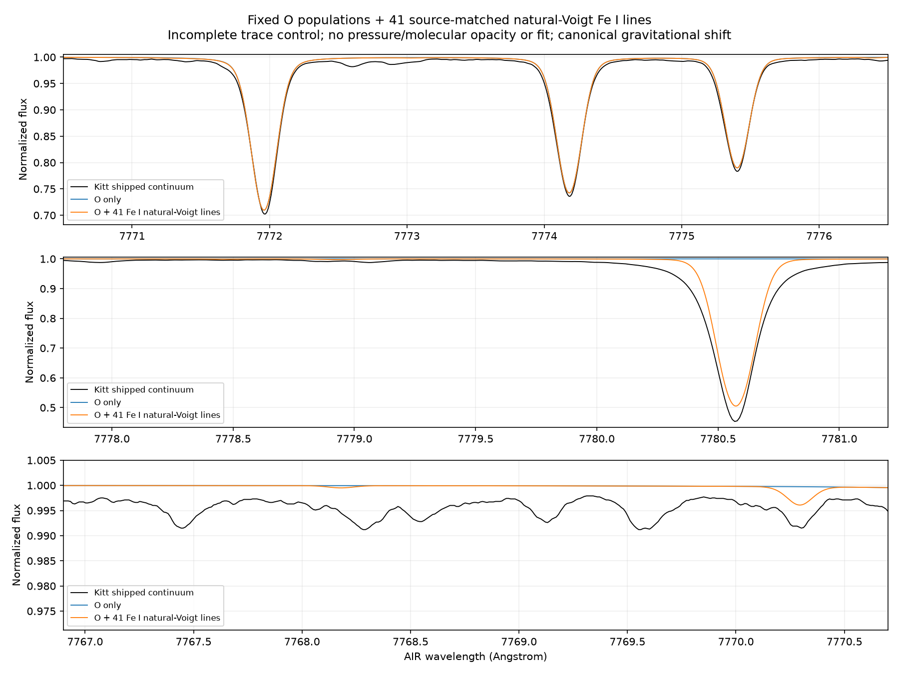

# Source-matched trace Fe I mixed-opacity control

RYA-1281, 2026-11-02, Mac only. Experimental fixed solar5772/g4.438/xi1/O8.70
populations; scientific HOLD. This is supporting passive opacity for oxygen,
not the future Fe abundance milestone or a complete mixed-spectrum model.

## Source intake and accounting

Existing prototype `pipeline/bride_lte_blend.py` already supplies SI natural-Voigt
LTE line coefficients. New intake matches the41 single-component canonical FeI
rows across7763-7783A to unique original installed-iSpec GESv6 rows, using AIR
wavelength/lower excitation/loggf at the source's printed precision. Canonical
gf/energy retained; natural damping read from `turbospectrum_rad` in s^-1 and
checked against the same row's log10 `rad`. One conversion AIR A to vacuum nm.
Source and canonical files are hash-receipted, full matched rows retained.

Six canonical combined-component entries explicitly excluded:
gf_064803/064804/064809/064813/064824/064829. No component splitting invented.
The other341 candidates in the prior388-row inventory are non-FeI and remain
outside this control. Natural damping is supported; source Stark/van-der-Waals
fields have NOT been implemented, nor pressure/HFS/isotope/molecular profiles.
No new download, source atom alteration or gf/damping adjustment.

The runner reconstructs the entire source selection before accepting its packet;
correct source-file hashes alone do not permit tampered derived coefficients.
A negative test changes loggf while retaining all hashes and is refused.
Original source/canonical rows, line packet and excluded entries remain immutable.

## Mixed transfer and population/EOS scope

`pipeline/bride_trace_fe_lines.py` wraps the existing exact-bound Fe background.
It delegates every callback, preserving full field/composition/cap refusals and
existing FeI bound-free replacement. Fe remains passive, preventing a duplicate
installed Fe line system. The41 new bound-bound extinctions and LTE thermal
emissivities enter the SAME transfer equation; scattering unchanged. No product
of independently normalized spectra and no second continuum added.

Trace lower-state populations use Kurucz LTE ionization/partition functions with
actual native composition and fixed local T/ne/nH/xi; no free Fe abundance. Its
neutral Fe reservoir differs from the limited native Fe atom by factors
1.030915-1.184614 across56 depths. Full depth table is retained. This is an
explicit mixed-reservoir approximation, not a newly consistent atmosphere/EOS or
FeNLTE solution. Do not tune this ratio to observations. Same O populations and
O bound-free continuum retained; no SE or electron-density feedback.

Opacity support explicitly limited to7763-7783A. The radiation/cap grid includes
all4001 VIS points in addition to the original packet/atom sampling. Natural
wings beyond the declared interval are absent; no UV/all-band opacity claim.
Static cache is instance-local and refuses changed local fields; base bound
provider still verifies geometry/velocity/composition/cap. Ray-grid coefficients
are computed on actual ray wavelengths, not an interpolated sharp-line profile.

## Paired controls and results

Two serial one-thread Mac replays use identical inputs/dense grid/continuum:
zero added lines and all41 natural-Voigt lines. Populations remain array-identical;
continuum arrays in the two outputs are exactly equal. Radiation/cap tolerance
1e-8, max1000 iterations,180s budget per replay; no original SE threshold changed.
Zero-line replay differs from prior wide baseline by only2.13922e-8, below the
original1e-6 outer criterion. This is an engineering replay check, not adoption.

|AIR O centre|Zero-line intrinsic mA|41-line intrinsic mA|Added mA|
|---|---:|---:|---:|
|7771.944|72.003817|72.083685|0.079868|
|7774.166|62.174417|62.325921|0.151504|
|7775.388|48.784118|48.792034|0.007916|

With canonical broadening and gravitational shift, added areas are
0.09464/0.15149/0.00940mA. Both declared RV variants are retained. This FeI
subset supplies too little DIRECT absorption in the O windows to explain the
remaining several-mA gap. That conclusion does not exclude other blends or
pressure-wing effects. No O abundance derived.

Maximum intrinsic profile difference0.60628 occurs in the wider region, not as
a60% change to the O triplet. A substantial FeI feature near7780.557A is restored
(source excitation4.473eV/loggf+0.029), independently illustrating neighboring
opacity. Its profile/width is not admitted; pressure broadening is absent.

## Continuum-anchor effect is larger than direct window contribution

Same existing ORCH robust estimator, fixed neighborhoods and corrected2005
holding. With these FeI lines, model-guided levels become
0.9967668/0.9963539/0.9928679, all numerically inside the existing3% bound.
Previously second/third estimates refused1.03447/1.13185. No threshold adjusted:
source opacity changed which pixels the model selected as continuum anchors.

Pre-clipping blue/red anchor counts: first90blue/0red, second23blue/67red,
third0blue/90red. First/third remain one-sided, so numerical pass does not certify
physical continuum. Corrected observed window areas74.56437/63.78702/46.99687mA;
third becomes WEAKER than the fixed model. Do not select this outcome to infer
abundance or declare the residual solved.

Existing IAG-reference control remains81.73581/70.81716/57.70338mA (unchanged,
as expected because reference/observation unchanged). Observed-envelope control
also unchanged74.10889/63.73224/49.94709. Reference spread remains open and is
not a formal A(O) uncertainty. Original shipped-continuum baseline untouched.

## Validation, compute and next task

29 tests pass:7 focused blend/source/provider tests plus22 cap/observable/
reference/continuum regressions with Mac host profile. Actual backend empty
wrapper identity; positive added opacity; unchanged scattering; LTE Kirchhoff
relation; deepcopy and live changed-input refusal; invalid/duplicate/out-of-domain
line data and tampered derived packet rejection. Kernel frequency-integral sum
rule independently retained. Weak-wing subtraction test uses an operand-scaled
floating-point roundoff bound, not an altered physical convergence threshold.
Initial test-module import error and overly relative weak-difference assertion
were corrected; no failed science result accepted or new verified production bug.

Final zero/natural replay10.754/11.041s, process-lifetime peak RSS698302464/
735723520bytes (~666/702MiB), recorded host loads,1thread. Memory includes imports
and setup, not earlier SE/grid/full3D measurements. Final v2 runs and source
packetv2 retained alongside earlier developmental roots. Reviewv3, synthesis/IAG
controlsv2 are final. Eleven compact artifacts and3figures archived byte-identical
under trace_fe_v1 with actual generator invocations. No original spectra/source
files/atom/binding/observations, gold/adopted or production ORCH changed.

Next qualify pressure-broadening conventions from the original source/backend;
retain a natural-only negative control and independently test line profiles.
Resolve6 combined-component FeI entries and other source-backed species/molecules,
then continuum-anchor geometry and reference spread, declared velocity/FTS-LSF
and fresh-bound xi controls. This limited success does not authorize a complete
opacity/EOS/SE claim. Oxygen first, C/N next, then Fe/another star. Scientific HOLD,
child In Progress/parent In Review; no merge/publication/adoption.
