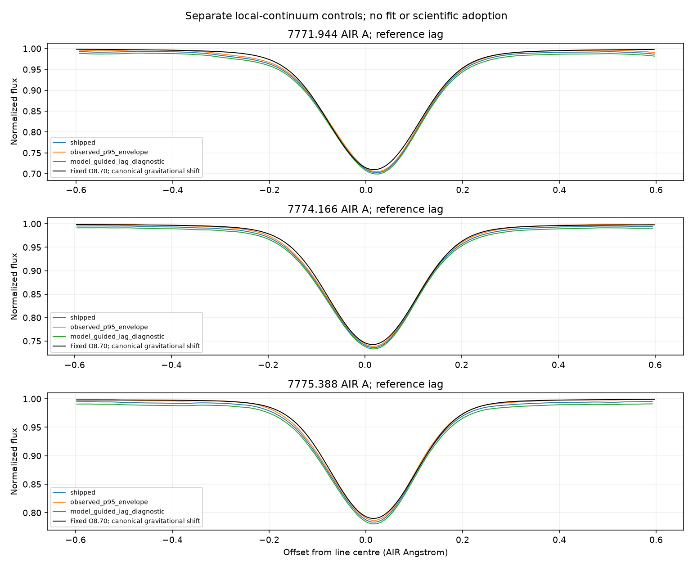
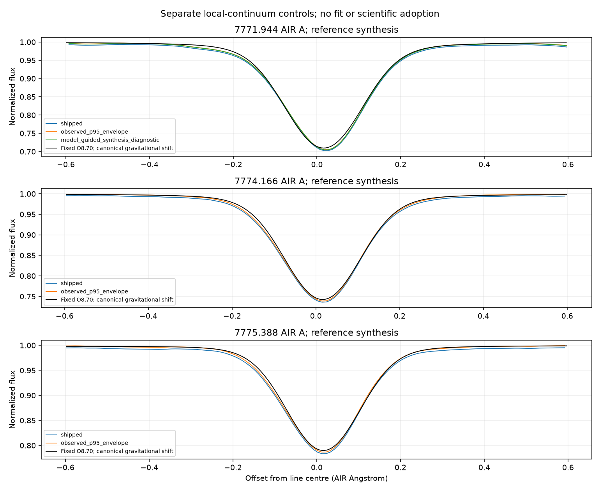

# Wide fixed-population oxygen and continuum-reference controls

RYA-1281, 2026-11-02. Experimental static1D O777 only; scientific HOLD.
Same solar5772/g4.438/xi1/O8.70 populations, exact-input Fe intervention,
density-integral/log-native-top cap, corrected2005 Kitt AIR product and declared
solar broadening/RV variants. No new SE, atmosphere/opacity scale or abundance fit.

## Wide flux and numerical replay

`scripts/replay_bride_wide_flux.py` validates the original manifest/flux, archived
fresh-rate population hash, atom, atmosphere sources, reconstructed complete
binding, provider/context and inherited cap equations. Rebuilds detailed-static
line/continuum contexts with unchanged populations and original bound-free
opacity. Radiation/cap converges at1e-8; fixed populations remain array-identical.
Collisions are not recalculated or used for SE in this detailed-static replay.

New AIR grid7763-7783A,4001points/.005A, five flux rays, same outer-cap observable.
All +/-5A continuum neighborhoods have >=2.6A extra padding. Recomputed original
coordinates match original normalized spectrum within3.31213e-12, below original
outer1e-6 tolerance. This is a replay check, not physical-spectrum validation.

Final v4 replay:5.86844s, single-thread context; process-lifetime peak RSS
616382464bytes (about588MiB), includes imports/setup. Host load averages
start2.8511/2.8521/2.3423, end2.9429/2.8711/2.3516. Timing begins after input
reconstruction. This does NOT retroactively measure memory of five earlier SE
solves or establish full3D/grid scaling. Earlier immutable v1-v3 retained;
v1 failed at an activeAtoms lookup because detailed-static O is not active.
Corrected to eqPops atomicPops before accepting output; not a physics fallback.

## Existing ORCH reference estimators, distinct controls

Extended residual audit uses existing RYA-1230/1232 p95 envelope and robust
model-guided estimators. Complete +/-5A model coverage now holds for all lines.
O-only nominal-reference levels:0.996768/1.034471/1.131853. First passes the
existing3% bound; second/third refuse. All90 initial anchors for each line are
one-sided (first blue, others red), selecting far from centre. A bound-passing
first-line value is therefore not evidence of a qualified physical continuum.
No failed/withheld operation silently becomes the observed-envelope result.

The existing IAG-reference sensitivity leg uses the registered Baker2020
**telluric-corrected** atlas, `solar_iag` holding gate, canonical AIR reader and
existing Gaussian catalog-R reference broadening. It is not raw Reiners2016.
Source FITS, reader, estimator and comparison hashes are recorded. No extra
observational RV/telluric adjustment or reference optimization. Existing atlas
span includes all three neighborhoods. No silent fallback when atlas unavailable.

|AIR centre|Shipped area mA|Observed-envelope mA|O-only guided mA|IAG-guided mA|
|---|---:|---:|---:|---:|
|7771.944|77.55651|74.10889|74.56549 (diagnostic)|81.73581|
|7774.166|67.20039|63.73224|REFUSED|70.81716|
|7775.388|53.79430|49.94709|REFUSED|57.70338|

IAG-reference levels1.0045516/1.0038924/1.0041485 all pass the numerical bound.
Initial anchors: first90blue/0red, second68blue/22red, third33blue/57red.
IAG reference therefore does not make every anchor geometry symmetric either.
At fixed model areas71.97199/62.15361/48.77347mA, IAG-control deficits become
11.95/12.23/15.48%, versus2.88/2.48/2.35% with observed envelope and7.2-9.3%
with shipped continuum. The reference choice changes area in opposite directions;
DO NOT select whichever yields agreement. This is reference/placement sensitivity,
not a formal abundance uncertainty or evidence a particular atlas is wrong.
No A(O) measurement or continuum is adopted.

## Blend qualification and next concrete task

Canonical atomic inventory has388 candidate rows across7763-7783A, including
47FeI/51FeII/45CaI/3OI. These are wavelength selections, not predicted strengths,
complete blend accounting or admitted transitions. Canonical table alone lacks
upper-level identity/complete damping data required for a qualified LW atomic
model. A read-only scan of existing native passive atoms found no bound-bound
transition centre in this span; enabling their existing lines alone will not
supply these neighbors. No new passive atom or mixed opacity was installed.
Do not multiply independent normalized spectra as a substitute for mixed opacity.
Molecular coverage remains unqualified.

Next qualify a source-backed local mixed-opacity route: resolve original atomic
line/damping/level inputs and composition/EOS/partition conventions, retain
active O populations and replace only the declared missing opacity in the SAME
transfer equation. Alternatively qualify a source-backed engine differential
with its own stated EOS/continuum limitations before interpreting it. Keep
O-only baseline and continuum-reference spread; do not assert all388rows matter
or invent missing damping/levels. Then test declared velocity/FTS-LSF and fresh
bound microturbulence controls. C/N before Fe/another star remains the goal.

## Verification and handoff

22 existing cap/observable/reference/local-continuum tests pass with Mac profile,
including actual native cap/ray test. Initial unprofiled21pass/1skip is retained
and explained: held atom path unavailable without profile, not hidden as pass.
Wide replay validates fixed populations and original-grid agreement at runtime.
Final artifacts and generator hashes checked; figures visually inspected.
No new verified science defect or production run-bug-ledger row. No raw/FITS,
adopted/gold, source atom/certificate, original spectrum or production ORCH change.

Final external roots: rya1281-wide-flux-v4,
rya1281-wide-synthesis-final-v1,rya1281-wide-iag-final-v1 under registered
experiments.bride_mac_grid. Earlier developmental roots retained. Four compact
artifacts archived at data/results/rya1281/wide_continuum_v1 and two figures at
data/output/rya1281/wide_continuum_v1, byte-identical to originals. Actual harness
invocations registered. Registerv199 and SEQUENCE updated; child In Progress,
parent In Review, stacked draft PR598. No merge/publication/adoption.
