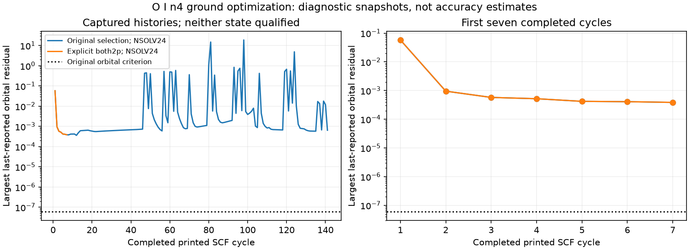

# RYA-1354: explicit relativistic component constraints

Continuation starts at45d4570bba5545a8eccf4db7b89bcd3d7b7a0934; original
baseadefcaf073ff70035954cf45a9a2283774ac7d06. Refreshed main remains
10f0dc955803253570a944ca37012654e80ead9f. Existing RYA-1354 worktree,
branch and draft PR616 retained. Exposed/nonblind, scientific HOLD. No
production/adopted gf, grade, abundance, canonical/reference or stellar change.

## Qualification correction and native proof

The previous relaxation control explicitly selected `2s,2p` (+`3s` odd) as
spectroscopic. Native GETRSL distinguishes `2p` from `2p-`; a bare `2p`
does not select both relativistic components. GETSCD initializes METHOD3;
GETOLD assigns METHOD1 only to explicitly selected spectroscopic components.
Native tables confirm the old `2p-` retains METHOD3. Earlier shorthand about
default node-checked verification was too broad: it covered the selected
spectroscopic components, not both physical 2p components or correlation orbitals.
This does **not** establish a wrong actual `2p-` node: observed node count is0,
as expected. Historical inputs/results remain unchanged and explicitly qualified.

Inspected pinned source SHA256:

| Source | SHA256 |
|---|---|
| getrsl.f90 | e95d87585fad6545646f591eefa0d88f6baff5668a426b1cdd70871325fbd4de |
| getold.f90 | 1585e5d08c53456c78787b461c264b6f47751c65f8c9757239a6efa7e808030c |

`rya1354_rsl_component_control.py` compiled a tiny Fortran caller against the
existing pinned native lib9290/libmod on Sirius. No atomic solve or solver-source
patch. Native inventory `[2s,2p-,2p,3s]` produces:

| Input | Selected native indices |
|---|---|
| 2s,2p | 1,3 |
| 2s,2p-,2p | 1,2,3 |
| 2p* | 2,3 |

`data/audit/rya1354/rsl_component_v8` preserves10native paths in one9594-byte
archive part, including exact fixture/stdin/output/build command/compiler and
library/source hashes/receipt. Native behavior, not a replica parser, proves
the distinction. Original GRASP source remains clean.

## Separately declared matched control

Linear and `lifetime_plan.v8.json` declared the experiment before launch.
Explicit spectroscopic `2s,2p-,2p` (+`3s` odd), unchanged full2s-SD/DC n4
CSFs/qualified initializers, vary2/3/4 and fix1s. Same NSOLV24 inner-iteration
floor, H0.03125/N439/originalACCY5.9604644775390625e-8/damping0.5/1500cycles.
No explicit2s METHOD3 override, failed-wave initializer or observed inputs.
Native defaults remain for other correlation orbitals. All3states must meet
strict orbital/physical identities and freshNSIC0 verification before13channel
lifetime. No automatic fallback, acceptance or calibrated uncertainty.

Existing `lifetime_relax_n4_nodebudget_v3` remains untouched as comparator.
Each owned run is single-thread/nice19; about9.6GiB available and127GiB disk
free before launch. Other workers preserved. Native command from resolved
Sirius task root:

```sh
OMP_NUM_THREADS=1 OPENBLAS_NUM_THREADS=1 nohup nice -n 19 python3 rya1354_lifetime_relax_v8.py --grasp-bin toolchains/grasp/build/bin --strict-bin toolchains/grasp-strict-scf-v1 --core runs/lifetime_core_n4_v1 --n 4 --damping 0.5 --cycles 1500 --radial-iteration-floor 24 --both-2p-spectroscopic --out runs/lifetime_relax_n4_pcomponents_v4 > runs_lifetime_relax_n4_pcomponents_v4.stdout 2> runs_lifetime_relax_n4_pcomponents_v4.stderr < /dev/null &
```

Initial driver2671600/rmcdhf2671651. New native tables confirm `2p-` METHOD1
with0nodes, in contrast to comparator METHOD3. Current execution is not a
qualified state or completed lifetime. Discover live arguments before using PIDs.
Watcher2671642,30second heartbeat `evidence/pcomponents_collection_v8/status.json`:

```sh
PYTHONPATH=. nohup nice -n 19 python3 evidence/collector_driver_method3_v6/rya1354_collect_pending.py --root . --out evidence/pcomponents_collection_v8 --campaign lifetime_relax_n4_pcomponents_v4 --watch > evidence/pcomponents_collection_v8.stdout 2> evidence/pcomponents_collection_v8.stderr < /dev/null &
```

The earlier nodebudget watcher remains active separately. Both archive terminal
success/failure without launching physics or granting scientific admission.

## Reproducible progress diagnostics

`rya1354_scf_history.py` separates outer cycles from inner `Iteration number:`
failures and retains unfinished printed cycles distinctly. It records actual
orbital method/node/residual tables and weighted energies. No stop waiver.
Snapshots are asynchronous read-only log prefixes, not atomic-cycle captures,
terminal campaign receipts or accepted wavefunctions.

`scf_logs_v8` preserves10snapshot files in one102449-bytepart. Every captured
file/hash and parsed history replays locally. At06:16:18UTC the comparator
printedcycle142 (141complete): last complete maximum residual0.000649 and
weighted energy-75.001541013Hartree, `2p-` METHOD3/node0. At06:16:45UTC the
explicit-component run printedcycle8 (7complete): maximum0.000387 and
energy-75.001478586Hartree, `2p-` METHOD1/node0. Both remain aboveACCY.
Comparator history has repeated large residual excursions; the first7cycles
of both histories are nearly coincident. No improved convergence/accuracy
is established by the short new sequence.



The dotted line is the original numerical orbital criterion, not an accuracy
interval or uncertainty bound. Native last-reported residuals are diagnostics.
Reproduce local plot (existing Mac Python3.12.13; no native solve):

```sh
python scripts/rya1354_scf_history.py --plot-bundle data/audit/rya1354/scf_logs_v8 --out data/audit/rya1354/scf_history_v8.png
```

Exact snapshot commands on Sirius:

```sh
python3 rya1354_scf_history_v8.py --run runs/lifetime_relax_n4_nodebudget_v3 --out evidence/nodebudget_log_snapshot_v8
python3 rya1354_scf_history_v8.py --run runs/lifetime_relax_n4_pcomponents_v4 --out evidence/pcomponents_log_snapshot_v8
```

These immutable output directories already exist; use new names for another
capture. If terminal receipt exists, collect the complete campaign instead.
Snapshot driver copies preserve the code used then; later local plot support
does not alter original capture bytes.

## Validation and next work

Tests cover native component-selection replay, identical historical defaults,
the sole explicit selection change for all3states and verification, native
METHOD3 versus METHOD1 in captured logs, original file hashes/history replay,
inner failure/unfinished cycle separation and nonmonotonic-history refusal.
Earlier v4/v5/v6/v7 scientific summaries replay unchanged. New bug-ledger row
characterizes the component-selection/qualification-description mismatch; no
unproven actual-state error or automatic regrading claimed.

Focused command (existing Mac Python3.12.13 metadata/native replay):

```sh
python -m pytest tests/test_rya1354_native_parts.py tests/test_rya1354_lifetime_path.py tests/test_rya1354_strict_scf.py tests/test_rya1354_decay_inventory.py tests/test_rya1354_nonblind.py tests/test_atomic_benchmark_rya1354.py tests/test_grade_governance_rya1352.py tests/test_line_census_rya1353.py tests/test_line_match_rya1033.py -q
```

**91passed in47.24s**. Native fixture/packing and local plot replay exit0; plot
visually inspected. Scientific self-review checked source/native behavior,
component selection, preserved comparator/defaults, diagnostic-only snapshots,
file/receipt identity and no premature physical acceptance. The characterization
remains open pending actual converged states; prior statements are corrected
without altering historical evidence. Original solver source clean, protected
production paths unchanged against task base. Whitespace and normal freshness
pass with existing informational stale-tracker notice; no state surfaces change.
Library audit retains pre-existing civis2013/mallinson2024 vocabulary errors and
exits1 before traversal. Post-commit guard, final SHA, push/current check status
and latest owned-job observations are recorded in Linear; no hosted-CI pass
inferred. Draft push retains documented exception for unrelated merged1352/1353
SEQUENCE debt, without bypassing file-size limits.

Read both native receipts and live watcher status. On terminal outcome, copy
stable full evidence into a NEW local directory and audit strict physical
qualification or preserve failure before another declared control. Larger
MR/active-space/radial/orbital convergence, independent relativistic checks and
experimental curation/calibration/covariance remain owed. The preliminary Cr
queue remains as documented in [v7](candidate_intake_and_node_control_v7.md),
not known-grade calibration truth. No merge/adoption/publication/Done.
