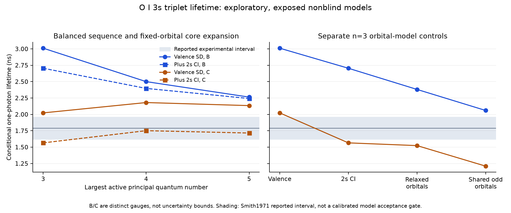

# RYA-1354 — balanced lifetime continuation

Scientific HOLD; exposed nonblind research. Start c38c22e02d365c2ab16d73f6e978fa9c492dfef5,
original task base adefcaf073ff70035954cf45a9a2283774ac7d06, same worktree/branch
and draft PR616. The user directed the continuation specifically along the lifetime
path. No atomic/stellar product, classification or abundance is adopted.

## Campaign and numerical failures

`config/atomic/rya1354/lifetime_plan.v4.json` records the choices and subsequent
explicit controls; each executed driver and frozen plan snapshot is preserved.
The full state sequence now starts by qualifying all reference radial functions,
then regenerates valence-SD n3/n4/n5 from verified previous-layer functions for
all three states. Every optimization gets a fresh NSIC0 restart before promotion.

The two coarse-grid reference attempts exhaust500 cycles: native methods1 and3
both leave the1s orbital above the native criterion. Neither promotes a layer.
The successful sequence uses H0.03125/N439 at the same endpoint throughout both
initialization and SCF, with original ACCY5.96046448e-8 explicitly preserved. The
numerical criterion is not silently recomputed after grid input. All reference and
n3/n4/n5 states and their fresh restarts pass, with leading parent/LS/J/parity and
physical downward ordering checked. The upstream GRASP installation remains
unchanged; the previously controlled strict orbital-stop variant is declared.

| Correlation layer | Conditional lifetime B / C (ns) |
|---|---:|
| Strict reference configurations | 5.512469 / 2.590946 |
| Balanced n3 | 3.010702 / 2.022878 |
| Balanced n4 | 2.500066 / 2.180713 |
| Balanced n5 | 2.263796 / 2.134024 |

All13 physical one-photon channels are retained, including weak/zero channels.
The primary Smith1971 value remains1.79+/-0.17ns, exposed and convention/dependence
limitations unchanged. Gauge or intermethod agreement does not provide a sigma.
The balanced n5 result remains discrepant; a consistent orbital sequence alone
does not eliminate missing-physics error.

## Fixed-orbital core controls

Every case uses all three matched verified states and all13 decay channels.
Identical-space native RCI/DC controls isolate interpolation before adding full
2s-hole SD configurations and then static-limit Breit. Recoil off,1s inactive,
point stationary Z8, no observed-energy substitution or lifetime fitting.

| n | VV DC B / C (ns) | Full2s SD DC B / C (ns) | Core plus Breit B / C (ns) |
|---|---:|---:|---:|
|3|3.010702 /2.022878|2.704375 /1.565104|2.704492 /1.564388|
|4|2.500066 /2.180713|2.396744 /1.751363|2.397750 /1.750981|
|5|2.263796 /2.134024|2.242242 /1.715416|2.242326 /1.714868|

Core expansion makes the gauges diverge rather than providing a calibrated
accuracy improvement. Breit is small for this allowed decay; the large forbidden
M1 sensitivity from the previous campaign cannot be transferred. Native energies,
line strengths and rates are retained separately, with theory-to-theory E1
A-ratio = energy-ratio cubed times strength-ratio diagnostics. No experimental
energy rescaling is hidden in these comparisons.

The n5 core result has one gauge near the primary datum while the other remains
substantially high. Neither gauge is selected as preferred. Native numerical
criteria and cross-method agreement alone have not established physical accuracy.

## Core-orbital and state-average controls

A separate full2s-SD n3 model reoptimizes n2/n3 orbitals while fixing1s, with
identical variational scope for ground/quintet/triplet. The initial ground attempt
hits500 cycles; an explicit damping control continues the same CSFs and qualifies
the ground. The quintet then hits500 cycles; its same-CSF continuation increases
only the iteration allowance to1500, keeping damping/grid/criterion/weights fixed.
All three final states and fresh NSIC0 restarts qualify before a lifetime is assembled.

A further separately declared model shares odd orbitals between3S1 and5S2 with
native statistical3:5 EOL weights, using the same qualified relaxed ground. This
is a distinct physical model, not a fallback relabeling. Its first500-cycle attempt
is retained/rejected; a same-CSF continuation qualifies and passes a fresh restart.
Individual J blocks are regenerated and solved with native RCI, not by editing
mixing coefficients. Both odd states use the same verified radial file. The native
RCI interpolation/grid convention remains explicit in this additional model.

| n3 model | Conditional lifetime B / C (ns) |
|---|---:|
| Fixed-orbital full2s SD/DC |2.704375 /1.565104|
| State-specific core-orbital reoptimization |2.380911 /1.523378|
| Shared odd3:5 EOL core-orbital model |2.059572 /1.209560|

The different variational models retain substantial and sometimes greater gauge
disagreement. A closer individual gauge is not an accuracy pass. Their unresolved
model dependence supports larger MR/active-space and Rydberg-targeted orbital
studies, not an uncertainty calibrated from gauge spread or method agreement.
No accepted physical convergence threshold has been inferred from these results.

The slow quintet continuation also has two complete, stable native ORBOUT snapshots.
A parser validates every sequential-record boundary, orbital identity, finite array
and unchanged radial grid. Snapshots near displayed iterations432/472 differ by
up to3.9e-6 in saved radial values while fixed1s is unchanged. Exact wave-to-cycle
timing is not asserted. This confirms continuing saved-wave changes; the diagnostic
never waives the declared orbital stopping criterion.

## Independent-method audit

The first newly written native HF driver used the wrong fixed-width closed-shell
layout. HF read an invalid `s` orbital instead of2s, emitted NaNs and failed radial
equations while still writing a partial wavefunction. The whole v1 independent
sequence is rejected, even where its rates look closer to experiment. The corrected
four-character shell fields and explicit native refusal/NaN checks prevent reuse.

Native MCHF also permits energy-only stopping. Its separately declared local
variant disables that acceptance and checks the current native DP1<=Z2 at the
actual stop, printing both values. The underlying orbital and CI updates are
unchanged. A one-cycle native upstream Si fixture gives byte-identical orbital
and mixing files in original/variant builds before stopping decisions diverge.
The initial build-wrapper Makefile continuation parse failed before compilation;
its artifacts remain on Sirius, and the corrected build is a separate directory.

Corrected MCHF at function parameter1e-9 passes n3/n4 but n5 upper stalls above its
criterion after500 cycles. That n5 result is rejected. The separately recorded
1e-8 tolerance control completes; a further sequence natively qualifies ALL
zero-replacement reference orbitals before freezing and repeating n3/n4/n5.
The reference is generated by GENCL rather than hand-editing coupling records.
This is an explicit tolerance/reference control, not an experimental fit.

| MCHF with qualified references | Inverse dominant E1 rate length / velocity (ns) |
|---|---:|
|n3|3.143379 /2.004474|
|n4|2.500531 /2.178284|
|n5|2.256440 /2.132310|

These are LS3S->3P **partial E1 inverse rates**, not a full independent
relativistic lifetime. GRASP's ground orbitals optimize a five-state EOL, while
MCHF optimizes the3P term; core/reference and relativistic/grid conventions differ.
Both share omitted correlations and development lineage. Close numbers cannot
calibrate absolute uncertainty or isolate relativity.

## Source review

Held Li2023 printedpp2-5/13 and Tables1/2/A1/A2 excerpt were inspected for method
context, not adopted as primary experiments. Its much larger MR/active spaces and
n2-core RCI differ from this pilot, and its energy-adjusted rates and gauge-based
uncertainty practice are not adopted. The new source receipt preserves the hash
and exact inspection limits.

Lawrence1970's official APS abstract/metadata were inspected as a possible
independent primary-lifetime lead; full PDF retrieval failed. No value or physical
transition is scored from that abstract. Li2023's quoted number is not promoted
into a primary-verified measurement. The bibliography lead records that limit.
Brooks1977 still reuses Smith1971 and is not another independent observation.

## Evidence and reproducibility

All numerical work stays on Sirius, pinned solvers/Python3.14.4/gfortran15.2.0,
single-thread and nice19. Mac Python3.12.13 performs source inspection/native-text
replay only. Other workers and source data remain untouched.

Size-bounded lossless tar parts include original native result files, CSFs,
wavefunctions, mixing files, labels, logs, prompts, drivers and original receipts.
Every part/member hash and receipt is checked after joining. Native `mcp.*` angular
caches and explicitly hashed `rci.res` Hamiltonian restart caches stay on Sirius.
Pinned `rci90/lodres.f90` and `matrix.f90` establish the latter as a regenerable
restart matrix, not a missing eigenstate/transition product. Offline validation
checks matching declared cache metadata; it does not reread external cache bytes.
Unknown or undeclared missing artifacts fail. Original source outputs are neither
modified nor deleted. A first pack attempt refused a single large restart cache;
its incomplete archive is not used. No artifact-size hook bypass is needed.

Evidence directories under `data/audit/rya1354/`:

- `lifetime_aux_v4b`: completed n3/n4 core controls, independent-method attempts,
  failed coarse reference runs and isolated strict MCHF build/software control.
- `lifetime_ladder_v4`: rebuilt reference/n3/n4/n5 sequence and the independent
  sequence with fully qualified reference orbitals.
- `lifetime_core_n5_v4`: direct balanced n5 core/DC/Breit experiment.
- `lifetime_relax_v4`: all relaxation/shared-odd attempts, complete successful
  models, saved-wave diagnostics, source snippets and final plan/source receipts.

Each directory's manifest declares exact part/member hashes and any retained
restart caches. The derived summary records all manifest hashes. A posthoc build
failure note is explicitly identified as such; it is not fabricated compiler output.
`rya1354_lifetime_summary.py` replays all native inventories, promotion/restart
identity, actual numerical criteria, energies/strengths, primary residuals and
independent-method limitations. Uncertainty/covariance and calibrated scores remain
null. Scientific review and accepted convergence criteria remain owed before
any adopted atomic product or publication.

## Reproduction commands

Commands below are relative to the isolated Sirius task root. Replays must choose
fresh output directories and update their explicit parent-directory arguments;
existing source/failed/successful outputs are not overwritten.

```sh
OMP_NUM_THREADS=1 OPENBLAS_NUM_THREADS=1 nice -n 19 python3 rya1354_lifetime_ladder.py --grasp-bin toolchains/grasp/build/bin --strict-bin toolchains/grasp-strict-scf-v1 --ground-seed runs/coverage_v8/ground --triplet-seed runs/coverage_v8/triplet_3s --quintet-seed solver_smoke_v10/grasp_3s_J2 --half-grid --out runs/lifetime_ladder_v3
OMP_NUM_THREADS=1 OPENBLAS_NUM_THREADS=1 nice -n 19 python3 rya1354_lifetime_core.py --grasp-bin toolchains/grasp/build/bin --ladder runs/lifetime_ladder_v3 --n 5 --out runs/lifetime_core_n5_v1
OMP_NUM_THREADS=1 OPENBLAS_NUM_THREADS=1 nice -n 19 python3 rya1354_strict_mchf.py --atsp toolchains/atsp2k-current --out toolchains/atsp-strict-scf-v2
OMP_NUM_THREADS=1 OPENBLAS_NUM_THREADS=1 nice -n 19 python3 rya1354_mchf_stop_control.py --atsp toolchains/atsp2k-current --strict-bin toolchains/atsp-strict-scf-v2 --fixture validation/mchf_native_control_v1 --out validation/mchf_stop_control_v1
OMP_NUM_THREADS=1 OPENBLAS_NUM_THREADS=1 nice -n 19 python3 rya1354_lifetime_mchf.py --atsp toolchains/atsp2k-current --book-bin toolchains/atsp-book-current/bin --strict-bin toolchains/atsp-strict-scf-v2 --function-tolerance 1e-8 --qualify-reference --out runs/lifetime_mchf_v4
OMP_NUM_THREADS=1 OPENBLAS_NUM_THREADS=1 nice -n 19 python3 rya1354_lifetime_relax.py --grasp-bin toolchains/grasp/build/bin --strict-bin toolchains/grasp-strict-scf-v1 --core runs/lifetime_core_n3_v1 --out runs/lifetime_relax_n3_v1
OMP_NUM_THREADS=1 OPENBLAS_NUM_THREADS=1 nice -n 19 python3 rya1354_lifetime_relax.py --grasp-bin toolchains/grasp/build/bin --strict-bin toolchains/grasp-strict-scf-v1 --core runs/lifetime_core_n3_v1 --damping 0.5 --resume-ground runs/lifetime_relax_n3_v1/ground --out runs/lifetime_relax_n3_v2
OMP_NUM_THREADS=1 OPENBLAS_NUM_THREADS=1 nice -n 19 python3 rya1354_lifetime_relax.py --grasp-bin toolchains/grasp/build/bin --strict-bin toolchains/grasp-strict-scf-v1 --core runs/lifetime_core_n3_v1 --damping 0.5 --cycles 1500 --resume-ground runs/lifetime_relax_n3_v2/ground_verify --resume-quintet runs/lifetime_relax_n3_v2/quintet --out runs/lifetime_relax_n3_v3
OMP_NUM_THREADS=1 OPENBLAS_NUM_THREADS=1 nice -n 19 python3 rya1354_lifetime_shared_odd.py --grasp-bin toolchains/grasp/build/bin --strict-bin toolchains/grasp-strict-scf-v1 --core runs/lifetime_core_n3_v1 --ground runs/lifetime_relax_n3_v2/ground_verify --out runs/lifetime_shared_odd_n3_v1
OMP_NUM_THREADS=1 OPENBLAS_NUM_THREADS=1 nice -n 19 python3 rya1354_lifetime_shared_odd.py --grasp-bin toolchains/grasp/build/bin --strict-bin toolchains/grasp-strict-scf-v1 --core runs/lifetime_core_n3_v1 --ground runs/lifetime_relax_n3_v2/ground_verify --cycles 1500 --resume-odd runs/lifetime_shared_odd_n3_v1/odd --out runs/lifetime_shared_odd_n3_v2
```

The first relaxation/shared-odd attempts above deliberately retain their actual
SCF-limit failures. Subsequent commands are explicit same-CSF continuations,
not silent fallback. The successful state-specific quintet/triplet require472/999
cycles after the earlier attempts; their fresh restarts require71/53 cycles.
The successful shared odd continuation requires271 cycles and37 on fresh restart.
Every accepted state satisfies the original declared ACCY; no relaxed criterion
is substituted for these GRASP results. MCHF's separately documented tolerance
control is distinct: n3/n4 dominant E1 rate changes from1e-9 to1e-8 function
parameters are zero at native printed precision except a2.5e-6 fractional n4
length-rate change. Neither that stability nor intermethod agreement calibrates
uncertainty. Native mass/Rydberg conventions are retained.

Mac reproduction (metadata/native-output replay only):

```sh
/Users/ryanschmitt/codex/venv/bin/python scripts/rya1354_lifetime_summary.py --plot
/Users/ryanschmitt/codex/venv/bin/python -m pytest tests/test_rya1354_lifetime_path.py tests/test_rya1354_strict_scf.py tests/test_rya1354_decay_inventory.py tests/test_rya1354_nonblind.py tests/test_atomic_benchmark_rya1354.py tests/test_grade_governance_rya1352.py tests/test_line_census_rya1353.py tests/test_line_match_rya1033.py -q
```



The figure is generated entirely from the versioned native replay JSON. It shows
gauge pairs as separate predictions, not error bounds. Shading is Smith1971's
reported interval, not a calibrated model-accuracy gate. Models outside the
plotted n3-5 correlation sequence, including the reference case, remain in JSON.

## Verification and exact continuation

Final focused regression run: **73 passed in24.45s**.

Focused regressions cover actual native promotion/restart identity and criteria,
all13 channels, exact source patches/software controls, invalid HF/iteration-limit
refusal, explicit restart-cache omissions, truncated/grid-mixed wave diagnostics
and byte-identical final summary replay. Three bug-ledger entries record the HF
layout defect (fixed), coarse-grid reference limitation (characterized), and
misleading native MCHF cap wording (characterized and refused by the new wrapper).

Register freshness normal and post-commit PR-mode checks require no state-surface
update: oxygen's adopted status/value/grade is unchanged. Production code, products,
canonical/reference lines, catalogs and stellar parameters remain unchanged.
The informational refinement-debt report has21 rows,10 not-fired ticket rows and5
no-ticket rows; none discharged. Bibliography/source-page generation still exits1
before traversal on pre-existing civis2013/mallinson2024 verified-state vocabulary
errors; no successful whole-library or regenerated-source-page check is claimed.
Hosted CI is recorded separately and is not scientific evidence or a research gate.

Next science work is a larger, Rydberg-targeted multireference/active-space study
with balanced core treatment, explicit orbital strategy and independent relativistic
checks. The inspected published protocol uses a far larger MR and active space;
its numerical results cannot be relabeled as this pilot's results. Extend accepted
models and convergence tests without selecting a gauge/model because it matches
experiment. Confirm primary experimental independence/conventions/covariances and
reviewed acceptance criteria before uncertainty calibration. No calibrated sigma,
publication, adopted atomic data, abundance result, merge or Done status follows
from this continuation. All owned solver jobs have finished; raw successful and
failed outputs remain on Sirius. PR616 stays draft and RYA-1354 In Progress/HOLD.
